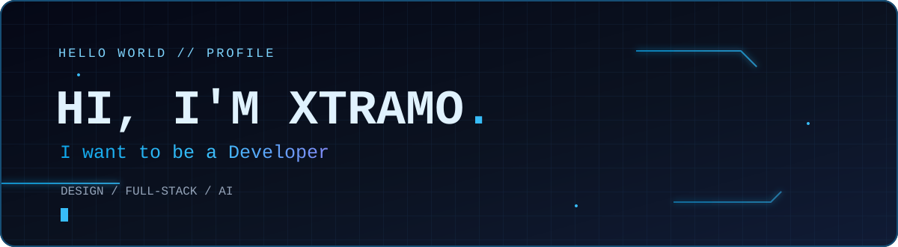

 

 

---

### `01` / A little about me

Hi, I'm **Xtramo** 👋

I'm someone who enjoys **design** and wants to understand more about what makes a good developer — not just how to write code, but how to think, solve problems, and build things that make sense.

- 🎨 I naturally gravitate toward **design, UI details, and user experience**.
- 🧩 I'm curious about **full-stack development** and how the pieces of an application work together.
- 🤖 I'm interested in **AI** and how it can help people create useful things.
- 🌱 I'm learning, experimenting, and figuring things out one step at a time.

`DESIGN` &nbsp; ✦ &nbsp; `DEVELOPMENT` &nbsp; ✦ &nbsp; `AI`

### `02` / Things I like exploring

### `03` / My GitHub corner

### `04` / Contribution activity

  

---

Still learning. Still curious. Always becoming. 💙

